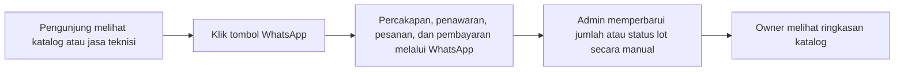

# Roadmap dan Prompt Pengembangan Fitur Admin & Owner — DLA AC

## 1. Tujuan dokumen

Dokumen ini menjadi panduan untuk mengembangkan akun **admin** dan **owner** pada website DLA AC. Isinya mencakup kondisi proyek saat ini, rancangan fitur, hak akses, tahapan pengerjaan, kriteria pengujian, dan prompt yang dapat diberikan kepada AI coding assistant.

> **Status:** ini adalah rencana pengembangan. Kotak yang belum dicentang tidak berarti fitur tersebut sudah tersedia. Perbarui statusnya hanya setelah fitur selesai dan diuji.

### Cara menggunakan roadmap

1. Tinjau keputusan pada **bagian 12**, terutama penyimpanan data, hak admin, dan statistik WhatsApp opsional.
2. Jika ingin dikerjakan sekaligus, salin **prompt utama pada bagian 10** ke AI coding assistant yang memiliki akses ke folder proyek ini.
3. Jika ingin dikerjakan bertahap, gunakan **prompt pada bagian 11** sesuai urutan tahap. Tahap 7 hanya dijalankan jika statistik klik dipilih.
4. Periksa hasil dan pengujian setiap tahap, lalu centang tugas yang benar-benar selesai. Gunakan bagian 8 sebagai daftar penerimaan.
5. Setelah fitur siap, ikuti bagian 9 untuk persiapan rilis. Isi kredensial langsung pada environment yang sesuai, bukan dalam prompt atau percakapan.

### Prinsip utama

- Website digunakan untuk menampilkan katalog jual beli AC borongan dan informasi jasa teknisi AC.
- Pelanggan menghubungi bisnis melalui **WhatsApp** untuk bertanya, memesan, dan menyepakati pembayaran.
- Admin memperbarui katalog dan status lot **secara manual** berdasarkan informasi yang diterima.
- Owner dapat menggunakan fitur admin, memantau katalog, dan mengatur akun admin serta kontak bisnis.
- Statistik klik WhatsApp adalah fitur **opsional** dan bukan bukti bahwa pesan terkirim atau penjualan terjadi.

### Di luar cakupan roadmap ini

Tidak perlu membuat pembayaran online, sistem checkout atau pencatatan pesanan di server, pencatatan pelanggan, laporan omzet atau laba, integrasi WhatsApp Business API, pembacaan percakapan, maupun jadwal teknisi otomatis. Website sudah memiliki **keranjang penawaran di browser** yang menyusun pesan WhatsApp; fitur tersebut tetap dipertahankan dan bukan sistem pesanan baru.

---

## 2. Kondisi proyek saat ini

Bagian ini berdasarkan struktur proyek lokal saat dokumen dibuat. Kondisi pada server tetap perlu diperiksa sebelum melakukan migrasi atau deployment.

### Teknologi dan halaman

- Next.js App Router, React, dan TypeScript.
- `app/page.tsx`: beranda, termasuk informasi jasa teknisi.
- `app/produk/` dan `app/produk/[id]/`: katalog dan detail lot.
- `app/keranjang/`: keranjang penawaran yang disimpan di browser pengunjung dan diteruskan ke WhatsApp.
- `app/admin/page.tsx` dan `components/admin/`: halaman pengelolaan katalog yang sudah ada.
- `components/contact-button.tsx`: tombol untuk memilih Admin Utama atau Admin 2 sebelum membuka WhatsApp.
- `app.js`: entry point Node.js untuk cPanel/Passenger.

### Yang sudah tersedia

| Bagian | Kondisi saat ini |
| --- | --- |
| Pengelolaan katalog | Tambah, ubah, hapus, unggah foto, atur jumlah, harga, dan status lot. |
| Status lot | `perlu-konfirmasi`, `tersedia`, `dalam-penawaran`, dan `terjual`. |
| Akun | Mode JSON menggunakan kata sandi bersama `ADMIN_PASSWORD`; mode MySQL mendukung akun individu owner/admin dan pengelolaan admin oleh owner. |
| Sesi | Cookie bertanda tangan dengan `ADMIN_SESSION_SECRET`; pada mode MySQL sesi memuat identitas dan versi sesi, serta akun/izin diperiksa kembali di server. |
| Pembatasan login | Percobaan login dibatasi dalam memori proses; tidak dibagikan otomatis antarproses. |
| Data katalog | JSON di `AC_DATA_DIR/lots.json` secara default; MySQL/MariaDB dapat dipilih setelah migrasi dan impor. |
| Foto unggahan | `AC_DATA_DIR/uploads/`, disajikan melalui `/api/images/[filename]`. |
| Data contoh | Jika `lots.json` belum ada, katalog memakai `exampleLots` dari `lib/lots.ts`; data ini ditandai sebagai contoh. |
| Nomor WhatsApp | Pengunjung memilih Admin Utama atau Admin 2. Nomor Admin 2 memakai `WHATSAPP_NUMBER` atau nomor default; nomor tidak valid ditampilkan sebagai tidak tersedia. |
| Jasa teknisi | Keterangan tampil di beranda dan dapat diperbarui admin/owner pada mode MySQL. |
| Statistik dan riwayat | Riwayat perubahan tersedia khusus owner pada mode MySQL. Statistik klik WhatsApp belum dibuat karena bersifat opsional. |

### API yang perlu diperhatikan

- `GET /api/products`: katalog publik.
- `POST`, `PUT`, dan `DELETE /api/admin/lots`: perubahan katalog.
- `POST /api/admin/upload`: unggah foto.
- `/api/admin/login`, `/api/admin/logout`, dan `/api/admin/session`: login dan sesi sesuai mode penyimpanan.
- `/api/admin/password` dan `/api/admin/settings`: kata sandi akun dan pengaturan jasa/kontak pada mode MySQL.
- `/api/owner/admins` dan `/api/owner/activity`: pengelolaan admin dan riwayat khusus owner.

**Catatan migrasi:** `lots.json` yang berisi array kosong berbeda dengan file yang belum ada. Jangan menganggap keduanya sama atau menampilkan ulang data contoh ketika katalog memang sengaja dikosongkan.

---

## 3. Alur bisnis yang dipertahankan



### Contoh

1. Pengunjung membuka detail `LOT-001` atau memilih beberapa lot di keranjang penawaran.
2. Pengunjung membuka WhatsApp dengan pesan yang sudah disiapkan website.
3. Kesepakatan dilakukan langsung melalui WhatsApp.
4. Jika ada perubahan ketersediaan, admin memperbarui jumlah atau status lot di dashboard.
5. Dashboard owner menampilkan ringkasan **status katalog**, bukan laporan penjualan atau penerimaan uang.

**Penting:** klik tombol WhatsApp hanya menandakan pengguna mencoba membuka tautan WhatsApp. Website tidak dapat memastikan bahwa pesan dikirim atau transaksi berhasil.

---

## 4. Role dan hak akses

### 4.1 Pengunjung

- Melihat beranda, katalog, detail lot, dan informasi jasa teknisi.
- Menggunakan pencarian, filter, dan keranjang penawaran yang sudah ada.
- Menghubungi DLA AC melalui WhatsApp tanpa membuat akun.

### 4.2 Admin

- Masuk dan keluar menggunakan akun masing-masing.
- Melihat ringkasan katalog dan status lot.
- Mengelola lot, foto, jumlah, dan status stok secara manual.
- Mengelola keterangan jasa teknisi yang tampil pada website.
- Mengubah kata sandi akun sendiri.
- Menggunakan WhatsApp secara langsung di luar dashboard untuk berkomunikasi dengan pelanggan.

### 4.3 Owner

- Menggunakan seluruh fitur operasional admin.
- Melihat ringkasan katalog dan lot yang memerlukan konfirmasi.
- Membuat dan menonaktifkan akun admin, serta mengatur hak akses yang disepakati.
- Mengatur nomor WhatsApp bisnis dan informasi bisnis yang termasuk dalam pengaturan website.
- Melihat riwayat perubahan penting.
- Jika fitur opsional dipilih: melihat statistik klik WhatsApp.

### 4.4 Matriks akses yang direkomendasikan

| Aksi | Pengunjung | Admin | Owner |
| --- | :---: | :---: | :---: |
| Melihat katalog, detail, dan informasi jasa | Ya | Ya | Ya |
| Menggunakan tombol dan keranjang penawaran WhatsApp | Ya | Ya | Ya |
| Melihat ringkasan katalog di dashboard | — | Ya | Ya |
| Menambah/mengubah lot, foto, jumlah, dan status | — | Ya | Ya |
| Mengubah harga lot | — | Ya* | Ya |
| Menghapus lot | — | Ya* | Ya |
| Mengubah informasi jasa teknisi | — | Ya | Ya |
| Mengubah nomor WhatsApp bisnis | — | — | Ya |
| Membuat/menonaktifkan akun admin | — | — | Ya |
| Mengatur hak akses admin | — | — | Ya |
| Melihat riwayat perubahan | — | — | Ya |
| Melihat statistik klik WhatsApp, jika dibuat | — | — | Ya |

\* **Rekomendasi awal:** admin boleh mengubah harga dan menghapus lot karena kemampuan tersebut sudah ada pada admin sekarang. Owner dapat menonaktifkan kedua hak ini per akun jika diperlukan. Pembatasan harus berlaku pada server/API, bukan hanya dengan menyembunyikan tombol.

---

## 5. Rancangan fitur dan aturan rinci

### 5.1 Login dan sesi

- Form login menggunakan **username dan kata sandi** akun masing-masing; tidak ada pendaftaran publik.
- Owner pertama dibuat melalui proses inisialisasi yang dijalankan secara eksplisit, bukan dengan kata sandi default di kode atau formulir publik.
- Username harus unik; kata sandi disimpan sebagai hash dengan salt menggunakan algoritma yang sesuai seperti `scrypt` dari Node.js atau library yang kompatibel dengan hosting.
- Sesi wajib memiliki identitas pengguna. Pada setiap permintaan terlindungi, server memeriksa bahwa akun masih aktif dan mengambil role/hak akses terbaru.
- Cookie sesi menggunakan `HttpOnly`, `SameSite` yang sesuai, masa berlaku yang jelas, dan `Secure` saat HTTPS. Login, logout, dan data sesi tidak boleh di-cache publik.
- Pertahankan pemeriksaan asal permintaan/CSRF yang sesuai dengan `APP_ORIGIN` dan konfigurasi proxy. Lakukan pembatasan percobaan login tanpa membocorkan kata sandi di log.
- Menonaktifkan akun, mengganti kata sandi, atau mengubah hak akses harus membuat sesi lama tidak lagi dapat digunakan atau memastikan hak terbaru selalu diperiksa.
- Ganti atau pisahkan mekanisme cookie lama yang hanya berisi masa berlaku. **Sesi `ac_admin_session` lama tidak boleh otomatis dianggap sebagai sesi admin atau owner baru.**
- Setelah sistem akun baru aktif, endpoint lama tidak boleh menjadi jalan pintas dengan hanya menggunakan `ADMIN_PASSWORD`. Sediakan migrasi dan petunjuk akses yang jelas agar pemilik tidak terkunci.

### 5.2 Kelola akun oleh owner

- Daftar admin menampilkan nama, username, status aktif, hak akses, dan waktu pembuatan. Jangan pernah mengembalikan hash atau kata sandi dalam respons API.
- Owner dapat membuat admin, menonaktifkan/mengaktifkan admin, mengatur ulang kata sandi, serta mengatur hak ubah harga dan hapus lot.
- Admin tidak dapat membuat akun, mengubah role sendiri, atau mengakses API khusus owner.
- Hindari kondisi tanpa owner aktif; pembuatan owner pertama dilakukan melalui proses inisialisasi yang aman dan dapat dijalankan ulang tanpa membuat akun duplikat.
- Gunakan kata sandi awal yang diberikan secara aman oleh pengelola; jangan mencetaknya di log atau menaruhnya pada repositori.

### 5.3 Katalog, stok, dan dashboard

- Pertahankan field dan perilaku lot yang ada di `lib/lots.ts`, termasuk `quantity`/`price` yang boleh belum diketahui, `priceUnit`, `isExample`, foto, dan empat status.
- Pertahankan validasi kode lot unik, jenis unit, jumlah/harga, dan foto. Jangan menganggap nilai `null` sebagai stok nol atau harga gratis.
- Dashboard menampilkan **jumlah lot** per status, bukan otomatis jumlah unit atau jumlah transaksi. Bedakan atau beri label jelas pada data contoh yang belum dikonfirmasi.
- Admin dan owner dapat memperbarui status/jumlah secara manual. Website tidak mengubah stok secara otomatis dari WhatsApp.
- Bila hak mengubah harga dicabut, API harus menolak perubahan `price`/`priceUnit` yang tidak diizinkan, termasuk permintaan langsung yang dimanipulasi. Saat membuat lot, tentukan perilaku harga kosong secara konsisten.
- Bila hak menghapus dicabut, API hapus harus menolak permintaan langsung meskipun pengguna tahu URL endpoint.
- Tetap dukung foto `client:` dan `upload:`, format JPEG/PNG/WebP, batas 8 MB per foto, dan maksimal delapan foto per lot sesuai perilaku saat ini.

### 5.4 Informasi jasa teknisi dan nomor WhatsApp

- Admin dan owner dapat mengubah keterangan jasa teknisi. Hanya owner dapat mengubah nomor WhatsApp bisnis.
- Gunakan teks layanan yang sudah ada sebagai nilai awal; wilayah, jam, harga, atau rincian layanan lain hanya ditampilkan jika memang diisi oleh pemilik. Jangan mengarang detail layanan.
- Nomor WhatsApp Admin Utama dan Admin 2 disimpan dalam format internasional Indonesia yang tervalidasi; pertahankan kompatibilitas aturan nomor di `lib/shop.ts`.
- Jika belum ada pengaturan tersimpan, pertahankan nomor awal Admin Utama serta perilaku `WHATSAPP_NUMBER` dan default Admin 2. Jika nomor tidak valid, jangan diam-diam mengirim pelanggan ke nomor lain; tampilkan pilihan tersebut sebagai tidak tersedia.
- Perubahan nomor harus berlaku konsisten di beranda, header, footer, katalog, detail produk, keranjang penawaran, dan tombol jasa teknisi.
- Data dan kredensial server harus tetap berada di server. Jika pembacaan pengaturan menjadi asynchronous, perbarui seluruh pemanggil `shopWhatsApp()` dan pisahkan modul server dari `whatsappUrl()` yang dipakai komponen client.

### 5.5 Riwayat perubahan

Fitur ini termasuk tahap pemantauan setelah fitur utama stabil.

- Simpan waktu, identitas pelaku, aksi, jenis target, ID/kode target, dan ringkasan perubahan yang relevan.
- Catat tindakan penting seperti membuat/mengubah/menghapus lot, mengubah status/harga, perubahan layanan/kontak, dan pengelolaan akun admin.
- Riwayat hanya dapat dibaca owner. Jangan simpan kata sandi, hash kata sandi, token, cookie, isi percakapan, atau pesan WhatsApp pelanggan.
- Jika katalog dan riwayat menggunakan database yang sama, simpan perubahan dan catatan audit dalam satu transaksi agar tidak saling bertentangan.

### 5.6 Statistik klik WhatsApp — opsional

Kerjakan hanya jika fitur ini dipilih. Fitur inti admin/owner tidak bergantung pada statistik ini.

- Catat klik tautan WhatsApp yang valid berdasarkan waktu dan sumber, misalnya beranda, detail produk, keranjang, atau jasa teknisi.
- Klik bukan bukti pesan terkirim, pesanan, atau penjualan. Tampilkan penjelasan tersebut pada dashboard.
- Hindari menyimpan isi pesan, nama pelanggan, nomor pelanggan, kota, atau catatan dari formulir keranjang.
- Pencatatan bersifat upaya terbaik: kegagalan pencatatan tidak boleh menghalangi tautan WhatsApp terbuka. Perhatikan klik pada tautan baru dan submit formulir keranjang agar perilaku yang ada tidak rusak.
- Gunakan validasi sumber, pembatasan penyalahgunaan yang sesuai, dan akses laporan hanya untuk owner.

---

## 6. Rekomendasi teknis dan data

### 6.1 Penyimpanan

Sistem saat ini menggunakan file JSON dan antrean tulis dalam satu proses Node.js. Untuk akun individu, perubahan stok oleh beberapa pengguna, dan riwayat perubahan, **direkomendasikan menggunakan MySQL/MariaDB** bila layanan tersebut tersedia pada cPanel hosting.

1. Periksa dukungan database, versi, dan akses cPanel terlebih dahulu. Jangan menganggap database atau kredensial produksi sudah tersedia.
2. Gunakan driver/library yang kompatibel dengan Node.js dan hosting. Siapkan migrasi skema yang dapat dijalankan ulang dan gunakan query terparameterisasi.
3. Sebaiknya simpan akun, hak akses, pengaturan, katalog, dan audit pada penyimpanan transaksional yang sama agar perubahan katalog dan audit dapat konsisten. Foto fisik tetap pada direktori unggahan persisten.
4. Jika MySQL/MariaDB tidak tersedia, tentukan alternatif bersama pemilik sebelum mengunci rancangan produksi. File JSON saat ini hanya cocok dipertimbangkan dengan batas satu proses dan keterbatasan konkurensi yang dijelaskan secara eksplisit.
5. Jangan menyimpan akun, hash, sesi, log, backup, atau konfigurasi privat pada lokasi yang dapat diakses publik. Periksa aturan document root dan proxy hosting.

### 6.2 Usulan entitas data

| Entitas | Data yang diperlukan |
| --- | --- |
| `users` | ID, nama, username unik, hash kata sandi, role, status aktif, versi sesi, waktu dibuat/diubah. |
| `admin_permissions` | Hak per admin, minimal ubah harga dan hapus lot; nilai awal sesuai keputusan matriks akses. |
| `lots` | Seluruh field `Lot` yang ada; pertahankan ID, kode, nilai kosong, status, harga, dan penanda contoh. |
| `lot_photos` | Urutan dan referensi foto yang mempertahankan format `client:` atau `upload:`. |
| `site_settings` | Nomor WhatsApp dan informasi jasa teknisi yang memang telah dikonfirmasi pemilik. |
| `audit_events` | Pelaku, waktu, aksi, target, dan ringkasan perubahan yang aman. |
| `whatsapp_clicks` | **Opsional:** waktu dan sumber klik tanpa isi pesan atau data pelanggan. |

Nama tabel dan detail skema dapat disesuaikan, tetapi kontrak fitur, validasi, dan hak akses harus tetap terpenuhi.

### 6.3 Migrasi dari data saat ini

- Periksa nilai `AC_DATA_DIR` pada lingkungan tujuan tanpa menampilkan isinya yang rahasia. Jika kosong, data default berada pada `./data` dari root aplikasi.
- Cadangkan `lots.json` dan folder `uploads/` jika ada, beserta data yang diperlukan untuk rollback. Simpan backup di lokasi privat, bukan di document root publik.
- Impor data dengan proses eksplisit, aman untuk dijalankan ulang, dan tidak menimpa data database yang sudah ada tanpa keputusan yang jelas.
- Pertahankan ID, kode, status, `isExample`, `null`, satuan harga, urutan foto, serta semua referensi gambar.
- Jika `lots.json` tidak ada, pertahankan perilaku data contoh yang diberi label. Jika `lots.json` ada tetapi kosong, pertahankan katalog kosong; jangan menyisipkan data contoh secara otomatis.
- Verifikasi jumlah dan contoh data sebelum/sesudah migrasi, uji URL foto unggahan, dan siapkan prosedur rollback untuk database, aplikasi, serta foto.
- Jangan mengubah atau menghapus `fotoac/`, data asli, foto unggahan, `.env`, atau konfigurasi hosting selama migrasi.

### 6.4 Rancangan halaman dan API

Nama di bawah adalah rekomendasi; implementasi boleh menyesuaikan struktur proyek selama perilaku dan hak aksesnya sama.

```text
/login                    Login admin dan owner
/admin                    Dashboard dan menu operasional
/admin/katalog            Pengelolaan lot dan foto
/admin/jasa-teknisi       Pengelolaan keterangan jasa
/owner                    Ringkasan owner
/owner/admin              Akun dan hak akses admin
/owner/pengaturan         Nomor WhatsApp dan informasi bisnis
/owner/aktivitas          Riwayat perubahan
/owner/statistik          Statistik klik WhatsApp, jika fitur dipilih
```

- Pertahankan akses dan perilaku publik `/`, `/produk`, `/produk/[id]`, `/keranjang`, `/api/products`, dan `/api/images/[filename]`.
- Pertahankan atau migrasikan API katalog dan upload yang ada secara terencana; semua mutasi harus memakai pemeriksaan identitas dan izin baru.
- Sediakan API login, logout, dan sesi baru; API akun/pengaturan/riwayat khusus owner; serta API konten jasa untuk role yang diizinkan.
- Berikan `401` ketika belum login dan `403` ketika akun tidak memiliki izin. Validasi data di server sekalipun sudah divalidasi di form.
- Jangan mengandalkan middleware, redirect, atau penyembunyian menu saja untuk melindungi API dan data.

---

## 7. Tahapan pengerjaan

### Tahap 0 — Persiapan dan keputusan awal

- [x] Baca `README.md`, `.env.example`, `app/admin/`, `app/api/admin/`, `lib/server/`, `lib/lots.ts`, `lib/shop.ts`, dan komponen WhatsApp.
- [ ] Periksa ketersediaan MySQL/MariaDB serta lingkungan Node.js pada hosting. Tentukan penyimpanan sebelum membuat migrasi produksi.
- [ ] Pastikan lokasi data dan foto yang benar; buat serta uji backup di lingkungan aman.
- [ ] Konfirmasi hak ubah harga dan hapus lot untuk admin. Rekomendasi awal: keduanya aktif dan dapat diubah owner.
- [ ] Konfirmasi teks dan informasi jasa teknisi yang boleh ditampilkan. Jangan menambahkan harga, wilayah, atau jam yang belum disepakati.
- [ ] Tentukan apakah statistik klik WhatsApp opsional akan dibuat sekarang atau ditunda.
- [x] Catat hasil pemeriksaan awal `npm run typecheck` dan build sebelum perubahan.

**Hasil pemeriksaan lokal:** Node.js v20.20.1; `npm run typecheck` dan `npm run build -- --webpack` lulus sebelum perubahan. `AC_DATA_DIR` tidak diatur pada lingkungan lokal dan direktori default `./data` belum ada; katalog menggunakan data contoh. Perintah MySQL/MariaDB tidak ditemukan secara lokal. Ketersediaan database, versi Node.js, lokasi data, dan backup pada hosting belum diperiksa.

**Selesai jika:** ruang lingkup, penyimpanan, akses, dan cara pemulihan data sudah jelas.

### Tahap 1 — Fondasi data dan migrasi

- [x] Siapkan koneksi penyimpanan, migrasi skema, dan konfigurasi melalui environment variables tanpa memasukkan kredensial ke kode.
- [x] Siapkan model akun, izin, lot/foto, dan pengaturan website.
- [x] Buat proses impor katalog yang idempotent sesuai bagian 6.3, termasuk kasus file tidak ada dan file kosong.
- [x] Pertahankan pembacaan foto dan kontrak katalog publik.
- [x] Perbarui `.env.example` dan README dengan placeholder serta petunjuk penggunaan lokal.

**Progres lokal:** penyimpanan JSON tetap menjadi default; skema MySQL/MariaDB dan impor hanya dijalankan secara eksplisit. Tes integrasi MySQL lokal lulus untuk migrasi berulang, data contoh, katalog kosong, pelestarian data/foto, penolakan impor tidak valid, dan penulisan bersamaan. Ketersediaan database, backup, serta proses migrasi di hosting masih perlu diperiksa sebelum rilis.

**Selesai jika:** data lama dan data contoh tetap ditampilkan sesuai semantik awal, foto dapat diakses, dan proses dapat diuji tanpa mengubah data produksi.

### Tahap 2 — Autentikasi dan role

- [x] Buat proses inisialisasi owner pertama yang eksplisit dan aman.
- [x] Buat login username/kata sandi, logout, sesi beridentitas, dan pembatasan akses admin/owner di server.
- [x] Pastikan akun nonaktif dan sesi lama tidak dapat digunakan.
- [x] Tutup atau migrasikan endpoint autentikasi lama agar tidak menjadi bypass.
- [x] Pertahankan validasi asal permintaan dan konfigurasi HTTPS/proxy yang sesuai.

**Progres lokal:** mode MySQL menggunakan akun individu, hash scrypt, sesi beridentitas, dan inisialisasi owner melalui terminal. Sesi lama ditolak pada mode MySQL; mode JSON tetap memakai login lama selama belum dimigrasikan. Tes lokal mencakup login, logout, penonaktifan, sesi lama, pembatasan harga/hapus, dan asal permintaan.

**Selesai jika:** owner dan admin dapat masuk sesuai role; akses tanpa sesi dan akses role yang salah ditolak, termasuk ketika API dipanggil langsung.

### Tahap 3 — Kelola akun dan izin admin

- [x] Buat halaman owner untuk melihat, membuat, menonaktifkan/mengaktifkan, dan mengatur ulang kata sandi admin.
- [x] Tambahkan pengaturan hak ubah harga dan hapus lot per admin.
- [x] Terapkan perubahan izin pada seluruh endpoint terkait, bukan hanya antarmuka.
- [x] Sediakan perubahan kata sandi akun sendiri dan penanganan sesi setelah perubahan.

**Progres lokal:** owner mengelola admin melalui dashboard mode MySQL; perubahan status, izin, atau reset kata sandi mengakhiri sesi admin terkait. Penggantian kata sandi sendiri mengakhiri seluruh sesi akun. API dan tampilan telah diuji pada database lokal dan browser, termasuk penolakan akses langsung oleh admin.

**Selesai jika:** owner dapat mengelola admin tanpa kebocoran kata sandi; perubahan status dan izin langsung berlaku pada sesi terkait.

### Tahap 4 — Dashboard dan pengelolaan katalog

- [x] Buat ringkasan jumlah lot per status untuk admin dan owner; tandai data contoh dengan jelas.
- [x] Sesuaikan formulir katalog dan upload yang sudah ada agar menggunakan sesi dan izin baru.
- [x] Pastikan owner dapat menggunakan menu admin.
- [x] Pertahankan validasi, pencarian/filter publik, detail produk, foto, dan keranjang penawaran.
- [x] Pastikan jumlah dan status diperbarui secara manual tanpa menyimpulkan adanya penjualan dari WhatsApp.

**Progres lokal:** ringkasan status dan data contoh tersedia untuk owner dan admin. Perubahan status, katalog kosong, foto, keranjang, sesi, serta pembatasan harga/hapus diuji pada penyimpanan lokal dan database uji.

**Selesai jika:** katalog publik tetap berfungsi, perhitungan sesuai data, dan pembatasan harga/hapus berlaku melalui UI maupun API.

### Tahap 5 — Konten jasa dan pengaturan WhatsApp

- [x] Buat form keterangan jasa teknisi untuk admin dan owner.
- [x] Buat pengaturan nomor WhatsApp khusus owner dengan validasi dan umpan balik yang jelas.
- [x] Hubungkan pengaturan tersimpan ke seluruh halaman dan tombol WhatsApp.
- [x] Pertahankan pesan khusus jasa teknisi, pesan katalog/keranjang, dan fallback jika nomor tidak tersedia.
- [x] Pastikan perubahan tampil pada website tanpa menyebabkan informasi pengguna terlindungi ikut ter-cache publik.

**Progres lokal:** admin dan owner dapat mengubah keterangan jasa, sedangkan kedua nomor WhatsApp hanya dapat diubah owner. Pengaturan memakai nilai awal yang ada sampai disimpan; tes lokal mencakup validasi, penolakan akses API admin untuk nomor, perubahan di semua halaman, dan pesan WhatsApp.

**Selesai jika:** perubahan konten/nomor tampil konsisten di halaman terkait, dan pengunjung tetap dapat membuka WhatsApp atau menggunakan fallback yang tersedia.

### Tahap 6 — Riwayat perubahan

- [x] Catat tindakan penting sesuai bagian 5.5 tanpa menyimpan rahasia atau isi pesan WhatsApp.
- [x] Buat halaman daftar riwayat yang hanya dapat diakses owner.
- [x] Terapkan transaksi untuk perubahan dan audit jika keduanya menggunakan database yang sama.
- [x] Uji bahwa admin tidak dapat membaca riwayat dengan memanggil API langsung.

**Progres lokal:** perubahan katalog/foto, akun, kata sandi, jasa, dan kontak tercatat dengan pelaku serta waktu. Owner melihat 100 aktivitas terbaru; API menolak admin. Tes juga memverifikasi rollback perubahan saat pencatatan audit gagal dan tidak adanya kata sandi dalam respons riwayat.

**Selesai jika:** owner dapat menelusuri pelaku, waktu, aksi, dan target dari perubahan yang diuji.

### Tahap 7 — Statistik klik WhatsApp, jika dipilih

**Status:** ditunda karena fitur opsional ini belum dipilih.

- [ ] Tetapkan sumber klik yang akan dihitung dan keterangan bahwa angka bersifat perkiraan.
- [ ] Tambahkan pencatatan yang tidak menghalangi tautan atau formulir WhatsApp.
- [ ] Buat ringkasan berdasarkan sumber/periode untuk owner tanpa data pribadi atau isi pesan.
- [ ] Uji kondisi ketika endpoint statistik tidak tersedia dan pastikan WhatsApp tetap terbuka.

**Selesai jika:** owner dapat melihat statistik, admin tidak dapat membacanya, dan angka tidak dinyatakan sebagai pesan atau penjualan.

### Tahap 8 — Pengujian, dokumentasi, dan persiapan rilis

- [ ] Jalankan daftar penerimaan pada bagian 8.
- [x] Perbarui README, `.env.example`, migrasi, instruksi inisialisasi owner, backup, dan pemulihan.
- [x] Jalankan typecheck, build, serta pengujian otomatis yang relevan.
- [ ] Uji di lingkungan staging yang setara dengan cPanel sebelum menerapkan ke domain produksi.
- [x] Siapkan langkah deployment, restart, pemeriksaan cache, dan rollback sesuai bagian 9.

**Hasil lokal:** `npm run typecheck`, `npm run build -- --webpack`, tes migrasi serta autentikasi pada MySQL 8 sementara, dan uji browser untuk akun, pengaturan, riwayat, katalog, serta WhatsApp lulus. MariaDB dan lingkungan hosting/staging belum diuji; pastikan database, backup, dan konfigurasi cPanel tersedia sebelum rilis.

**Selesai jika:** seluruh fitur utama lolos pemeriksaan dan hasil yang belum dapat diuji dilaporkan secara jelas.

---

## 8. Daftar pengujian penerimaan

### A. Akun dan hak akses

- [x] Owner pertama dapat dibuat hanya melalui proses inisialisasi yang dimaksud; menjalankannya lagi tidak membuat duplikat.
- [x] Login dan logout bekerja untuk owner dan admin; kredensial salah ditolak.
- [x] Pengunjung tidak dapat membuka data/API privat; respons tidak terautentikasi adalah `401` atau diarahkan ke login untuk halaman.
- [x] Admin mendapat `403` saat memanggil API khusus owner secara langsung.
- [x] Sesi lama berbasis kata sandi bersama tidak dapat digunakan untuk memperoleh role baru.
- [x] Akun yang dinonaktifkan dan sesi yang dicabut tidak dapat melanjutkan akses.
- [x] Admin yang tidak diberi hak harga/hapus ditolak oleh server saat mencoba memanipulasi permintaan.
- [ ] Tidak ada kata sandi, hash, cookie, atau secret pada respons publik, log, contoh environment, atau file yang disajikan publik.

### B. Katalog dan data lama

- [x] Lot lama, jumlah, harga, status, penanda contoh, urutan foto, dan referensi foto tetap sama setelah migrasi.
- [x] Skenario `lots.json` tidak ada dan `lots.json` berisi `[]` menghasilkan perilaku yang sesuai.
- [x] Validasi field dan batas unggah foto tetap bekerja; foto lama dan baru dapat ditampilkan.
- [x] Ringkasan menghitung lot berdasarkan status dan tidak mengubah data contoh menjadi stok terkonfirmasi.
- [x] Katalog publik, pencarian/filter, detail, keranjang, dan tombol WhatsApp tetap berfungsi.

### C. Layanan dan pengaturan

- [x] Admin dan owner dapat mengubah keterangan jasa teknisi.
- [x] Hanya owner dapat mengubah nomor WhatsApp; nomor tidak valid ditolak dengan pesan yang jelas.
- [x] Nomor yang tersimpan digunakan di semua titik kontak, termasuk keranjang dan jasa teknisi.
- [x] Nomor yang tidak tersedia ditampilkan sebagai tidak tersedia tanpa mengarahkan ke nomor lain.
- [ ] Halaman publik dan API privat tidak menyajikan perubahan atau data sesi yang kedaluwarsa akibat cache.

### D. Riwayat dan statistik opsional

- [x] Perubahan penting tercatat dengan pelaku dan waktu; hanya owner dapat membaca riwayat.
- [x] Tidak ada isi pesan WhatsApp, data formulir pelanggan, kata sandi, atau token di riwayat.
- [ ] Jika statistik dibuat, klik dicatat menurut sumber tanpa menghalangi WhatsApp; laporan tidak menyebut klik sebagai pesan atau transaksi.

### E. Tampilan dan operasional

- [x] Halaman dapat digunakan pada layar ponsel dan desktop; form memiliki label, pesan error, dan status yang dapat dipahami.
- [x] Pengaturan server, backup, inisialisasi owner, migrasi, dan rollback sudah didokumentasikan.
- [x] Jalankan `npm run typecheck`, build, dan tes keamanan/fungsi yang relevan. Laporkan tes yang memerlukan database/hosting jika belum dapat dijalankan.

---

## 9. Catatan deployment cPanel

Pada konfigurasi hosting yang pernah digunakan, aplikasi berjalan dengan Node.js Selector/Passenger dan `node_modules` berupa symlink ke `nodevenv`. Build Turbopack pernah gagal karena resolusi symlink; build dengan Webpack berhasil. Kondisi hosting dapat berubah, jadi periksa kembali sebelum rilis.

Contoh perintah setelah file diunggah dan lingkungan tujuan sudah dikonfirmasi:

```bash
source /home/jannahdi/nodevenv/dla-ac.com/24/bin/activate
cd /home/jannahdi/dla-ac.com
npm run typecheck
npm run build -- --webpack
```

Jika versi atau lokasi environment berubah, gunakan perintah aktivasi yang ditampilkan cPanel. Instal dependensi baru di environment aplikasi bila memang ada perubahan dependensi, lalu jalankan migrasi sesuai petunjuk implementasi. Restart aplikasi dari **Setup Node.js App** setelah build dan migrasi berhasil.

### Hal yang harus diperiksa saat rilis

1. Gunakan backup yang sudah diverifikasi dan jalankan migrasi terlebih dahulu di staging.
2. Jangan menimpa `.htaccess`, `.env`, data, foto unggahan, atau symlink `node_modules` dengan salinan dari lingkungan lain.
3. Pastikan data privat tidak dapat diakses melalui document root; foto yang memang publik tetap dilayani melalui mekanisme aplikasi.
4. Uji login kedua role, katalog, foto, pengaturan nomor, dan tombol WhatsApp setelah restart.
5. Hosting pernah menyajikan halaman lama dengan `X-Cache-Status: STALE` untuk varian `zstd`. Uji URL utama **tanpa query** dan perubahan katalog/pengaturan dari browser; pastikan cache/proxy tidak menyimpan respons privat atau konten dinamis yang sudah usang. Jika perlu, minta provider membersihkan cache untuk seluruh variasi encoding.
6. Simpan prosedur rollback yang mengembalikan versi aplikasi, database, dan foto yang saling sesuai. Jangan menjalankan migrasi atau deployment produksi tanpa instruksi dan akses yang sesuai.

---

## 10. Prompt utama untuk AI coding assistant

Salin prompt berikut jika ingin meminta AI mengerjakan fitur utama secara menyeluruh. Prompt ini mengarahkan AI untuk memeriksa kondisi aktual, mengimplementasikan perubahan, dan menguji hasilnya.

```text
Anda adalah senior full-stack engineer yang bekerja pada proyek DLA AC ini.

Baca file `Roadmap-fitur-admin&owner.md` secara utuh, lalu periksa kode dan konfigurasi proyek yang ada. Implementasikan fitur utama admin dan owner sesuai tahap 0 sampai 6 dan tahap 8. Kerjakan sampai selesai, bukan hanya memberikan rencana.

Konteks bisnis:
- Website menampilkan katalog jual beli AC borongan dan informasi jasa teknisi.
- Semua percakapan, kesepakatan pesanan, dan pembayaran tetap melalui WhatsApp.
- Pertahankan keranjang penawaran yang sudah ada sebagai penyusun pesan WhatsApp di browser.
- Jangan menambahkan sistem pembayaran, pesanan di server, pelanggan, laporan omzet/laba, atau integrasi pembacaan WhatsApp.

Implementasikan:
1. Akun owner dan admin individu, proses inisialisasi owner pertama yang aman, login/logout, sesi beridentitas, serta pengecekan role dan izin di server.
2. Dashboard ringkasan katalog untuk kedua role. Owner dapat menggunakan seluruh menu admin.
3. Kelola katalog, status, jumlah, dan foto dengan mempertahankan validasi serta perilaku publik yang ada.
4. Owner dapat membuat/menonaktifkan admin, mengatur ulang kata sandi, dan mengatur izin ubah harga/hapus per admin. Terapkan izin langsung pada API.
5. Admin dan owner dapat mengubah keterangan jasa teknisi; owner dapat mengatur nomor WhatsApp. Gunakan nilai awal dan fallback yang sudah ada, tanpa mengarang informasi usaha.
6. Riwayat perubahan penting yang hanya dapat dibaca owner dan tidak menyimpan rahasia atau isi pesan pelanggan.

Ketentuan teknis:
- Periksa apakah MySQL/MariaDB tersedia dan sesuai dengan cPanel. Gunakan penyimpanan transaksional yang kompatibel untuk produksi, dengan konfigurasi melalui environment variables dan migrasi yang dapat dijalankan ulang. Jika prasyarat database belum tersedia, kerjakan bagian independen yang memungkinkan, jelaskan batasannya, dan tanyakan keputusan yang diperlukan; jangan mengklaim integrasi sudah diuji.
- Pertahankan dan migrasikan data `lots.json` serta foto sesuai roadmap. Bedakan file yang belum ada dari array kosong; pertahankan ID, status, nilai null, penanda contoh, dan referensi foto. Jangan menimpa data produksi.
- Sistem lama memakai `ADMIN_PASSWORD` dan cookie tanpa identitas. Pastikan keduanya tidak menjadi bypass setelah role baru aktif. Buat proses transisi dan dokumentasi akses owner yang jelas.
- Terapkan pemeriksaan izin pada API, validasi server, proteksi sesi/asal permintaan, pembatasan percobaan login, dan cache privat yang sesuai. Jangan menaruh password, token, atau kredensial database di kode, log, atau dokumentasi.
- Pertahankan tampilan dan pola proyek, kompatibilitas `app.js` dengan cPanel/Passenger, symlink `node_modules`, dan build Webpack pada hosting. Jangan menimpa `.htaccess`, `.env`, foto, atau data yang ada.
- Statistik klik WhatsApp pada tahap 7 adalah opsional. Jangan mengimplementasikannya kecuali diminta; jika diminta, ikuti syarat privasi dan pastikan WhatsApp tetap terbuka saat pencatatan gagal.
- Gunakan dokumentasi Next.js yang sesuai versi proyek jika diperlukan. Jangan melakukan commit, push, atau deployment produksi tanpa instruksi terpisah.

Tambahkan pengujian yang bermakna untuk autentikasi, otorisasi langsung ke API, migrasi data, katalog, pengaturan WhatsApp, dan riwayat perubahan. Jalankan `npm run typecheck`, build yang sesuai, dan tes yang tersedia. Perbarui README dan `.env.example` dengan instruksi inisialisasi, migrasi, backup, serta rollback tanpa nilai rahasia.

Di akhir, jelaskan fitur yang selesai, file yang diubah, perubahan environment/database, hasil pengujian yang benar-benar dijalankan, bagian yang masih terblokir, dan langkah deployment untuk cPanel.
```

---

## 11. Prompt per tahap

Gunakan pilihan ini jika ingin mengerjakan secara bertahap. Jalankan sesuai urutan dan berikan hasil tahap sebelumnya kepada AI sebelum melanjutkan. Setiap prompt merujuk ke file roadmap ini agar aturan WhatsApp dan hak akses tetap sama.

### Prompt 0 — Pemeriksaan dan persiapan

```text
Baca `Roadmap-fitur-admin&owner.md` dan periksa proyek DLA AC saat ini. Kerjakan Tahap 0: petakan autentikasi, data katalog/foto, titik WhatsApp, kompatibilitas cPanel, kebutuhan database, dan risiko migrasi. Jalankan pemeriksaan awal yang aman. Laporkan keputusan dan jenis konfigurasi yang masih dibutuhkan; jangan meminta atau menampilkan nilai kredensial dalam percakapan. Jangan mengubah data produksi.
```

### Prompt 1 — Data dan migrasi

```text
Baca roadmap DLA AC dan kerjakan Tahap 1 menggunakan penyimpanan yang telah diputuskan. Siapkan skema, konfigurasi, dan impor katalog yang dapat dijalankan ulang. Pertahankan perbedaan file katalog yang tidak ada dan file kosong, data contoh, ID, nilai null, serta foto. Tambahkan pengujian migrasi dan petunjuk backup/rollback. Jangan menyentuh data produksi.
```

### Prompt 2 — Login dan hak akses

```text
Baca roadmap DLA AC dan kerjakan Tahap 2. Buat inisialisasi owner pertama yang aman, login/logout untuk akun individu, sesi beridentitas, dan pemeriksaan role pada server/API. Pastikan cookie dan password bersama yang lama tidak menjadi bypass. Tambahkan pengujian login, sesi nonaktif, akses tanpa autentikasi, dan akses role yang salah.
```

### Prompt 3 — Pengelolaan admin

```text
Baca roadmap DLA AC dan kerjakan Tahap 3. Buat menu owner untuk membuat, menonaktifkan/mengaktifkan, dan mengatur ulang kata sandi admin; tambahkan izin ubah harga dan hapus lot. Pastikan admin tidak bisa memanggil API owner atau melewati pembatasan melalui request langsung. Uji seluruh alur dan jangan tampilkan hash atau kata sandi di API/log.
```

### Prompt 4 — Dashboard dan katalog

```text
Baca roadmap DLA AC dan kerjakan Tahap 4. Hubungkan dashboard dan pengelolaan katalog yang sudah ada ke sistem akun/izin baru. Tampilkan ringkasan lot per status dengan penanda data contoh, pertahankan validasi/foto/katalog/keranjang, dan pastikan stok tetap diperbarui manual. Uji penggunaan admin, owner, pengunjung, dan pembatasan API.
```

### Prompt 5 — Jasa teknisi dan WhatsApp

```text
Baca roadmap DLA AC dan kerjakan Tahap 5. Buat pengelolaan keterangan jasa teknisi untuk admin/owner dan pengaturan nomor WhatsApp khusus owner. Hubungkan ke seluruh halaman, detail, footer, tombol jasa, dan keranjang; pertahankan fallback nomor serta pesan WhatsApp yang ada. Jangan mengarang informasi layanan. Uji akses, validasi, dan seluruh titik kontak.
```

### Prompt 6 — Riwayat perubahan

```text
Baca roadmap DLA AC dan kerjakan Tahap 6. Catat aksi penting dengan pelaku, waktu, dan target; tampilkan riwayat hanya kepada owner. Pastikan data perubahan konsisten dengan penyimpanan dan tidak mencatat rahasia, isi chat, atau data formulir pelanggan. Uji akses langsung ke API dan peristiwa yang dicatat.
```

### Prompt 7 — Statistik WhatsApp opsional

```text
Baca roadmap DLA AC dan kerjakan Tahap 7 saja. Tambahkan statistik jumlah klik WhatsApp per sumber/periode untuk owner, tanpa menyimpan isi pesan atau data pribadi. Jangan menganggap klik sebagai pesan terkirim atau penjualan. Pastikan kegagalan pencatatan tidak menghambat tautan WhatsApp maupun formulir keranjang. Uji hak akses dan fallback.
```

### Prompt 8 — Pengujian dan kesiapan rilis

```text
Baca roadmap DLA AC dan kerjakan Tahap 8. Jalankan pemeriksaan penerimaan, typecheck, tes yang relevan, dan build Webpack yang sesuai dengan cPanel. Perbarui dokumentasi environment, inisialisasi owner, migrasi, backup, rollback, restart Passenger, dan pemeriksaan cache. Laporkan hasil aktual serta hambatan; jangan deploy ke produksi atau melakukan commit/push tanpa instruksi.
```

---

## 12. Ringkasan keputusan yang perlu dikonfirmasi

| Pertanyaan | Rekomendasi awal |
| --- | --- |
| Di mana data disimpan? | MySQL/MariaDB jika tersedia dan sesuai dengan hosting; foto tetap pada penyimpanan persisten. |
| Bolehkah admin mengubah harga dan menghapus lot? | Boleh secara default, dengan izin yang dapat diubah owner. |
| Siapa yang mengatur nomor WhatsApp? | Owner. |
| Apakah konten jasa teknisi bisa diubah admin? | Ya; hanya tampilkan informasi yang telah diberikan pemilik. |
| Apakah statistik klik WhatsApp dikerjakan sekarang? | Opsional; putuskan sebelum Tahap 7. |
| Apakah pembayaran/pesanan dicatat oleh website? | Tidak; percakapan dan kesepakatan tetap melalui WhatsApp. |
| Apakah status stok berubah otomatis dari WhatsApp? | Tidak; admin atau owner memperbarui secara manual. |

> Roadmap ini dapat diperbarui setelah kebutuhan klien dikonfirmasi. Simpan kata sandi, secret sesi, dan kredensial database di pengaturan environment yang aman, bukan di file roadmap.
